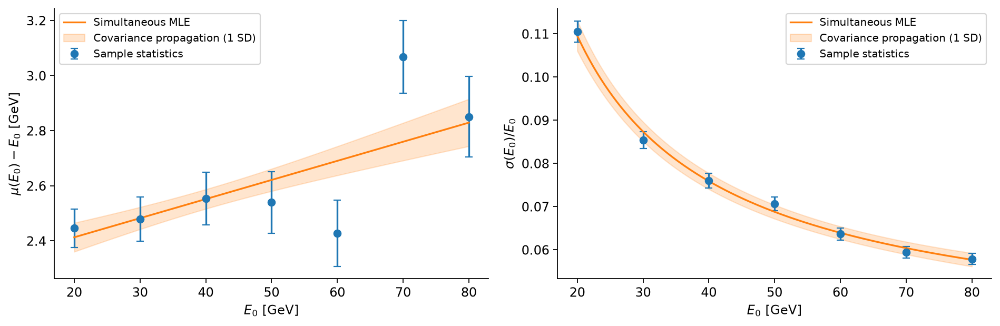

# Detector calibration with likelihood fits

Estimate the energy response and resolution of a detector from a calibration sample, comparing sample statistics, separate Gaussian likelihood fits and a simultaneous event-level likelihood. The complete analysis is in [calibration.ipynb](calibration.ipynb), with numerical and plotting helpers in `s1_sol/`.

## Model and methods

The measured energy is Gaussian, with true energy $E_0$ and

$$\mu(E_0)=\lambda E_0+\Delta,\qquad\sigma^2(E_0)=a^2E_0+b^2+c^2E_0^2.$$

The analysis compares three estimators:

- Sample means and widths at each energy, followed by weighted least squares.
- Separate unbinned Gaussian fits at each energy, followed by the same trend fits.
- One unbinned likelihood fit of all five parameters to all events.

HESSE errors are compared with standard deviations from 2500 whole-sample bootstrap replicates (seed 42). The bootstrap resamples paired true and measured energies. Resolution parameters use the bounds $a\geq0.01\sqrt{\mathrm{GeV}}$, $b\geq0.01$ GeV and $c\geq0.001$.

## Results

For the supplied calibration sample of 7000 entries, the simultaneous fit gives:

| Parameter | Estimate ± HESSE standard error | Unit |
|---|---:|---|
| $\lambda$ | 1.00694 ± 0.00197 | Dimensionless |
| $\Delta$ | 2.2741 ± 0.0874 | GeV |
| $a$ | 0.3729 ± 0.0576 | $\sqrt{\mathrm{GeV}}$ |
| $b$ | 1.2150 ± 0.3232 | GeV |
| $c$ | 0.03686 ± 0.00674 | Dimensionless |

The three methods give similar point estimates. The simultaneous fit has smaller local errors for the resolution parameters in this sample. The bootstrap distributions show the effect of weakly constrained resolution terms and parameter boundaries; comparing bootstrap and HESSE errors does not itself establish confidence-interval coverage.



The notebook contains the full comparison and bootstrap plots. [results.json](results.json) records the fitted values and errors; [bootstrap_summary.json](bootstrap_summary.json) records the bootstrap means, standard deviations and random seed.

## Data

The calibration problem and input sample were supplied by Matt Kenzie for the S1 coursework. The sample represents the course's detector-response model and is not distributed here.

Place the course-provided `sample.csv` in `data/`, or set `S1_DATA_PATH` to its location. The CSV requires `E_true` and `E_rec` columns, both in GeV. The results above use 1000 entries at each true energy from 20 to 80 GeV in steps of 10 GeV. Other input samples will give different estimates.

## Run

Python 3.13 was used for the saved outputs. Dependencies are NumPy, pandas, SciPy, Matplotlib, iminuit and JupyterLab; versions are recorded in `requirements.txt`.

```bash
python3 -m venv .venv
source .venv/bin/activate
python -m pip install -r requirements.txt
jupyter lab calibration.ipynb
```

Select the environment's Python kernel and run all cells in order. The notebook writes the result JSON files and two figures in `figs/`; the full bootstrap is the longest step. Change `N_BOOTSTRAP` in the setup cell for a shorter exploratory run.

To execute without opening JupyterLab:

```bash
jupyter nbconvert --to notebook --execute --inplace \
  --ExecutePreprocessor.timeout=1800 calibration.ipynb
```

## References

- Matt Kenzie, *S1 Statistical Methods coursework*, Cambridge MPhil in Data Intensive Science, 2025/26: calibration model and input sample.
- [iminuit fitting and uncertainty estimation](https://scikit-hep.org/iminuit/notebooks/basic.html) and [cost functions](https://scikit-hep.org/iminuit/notebooks/cost_functions.html).
